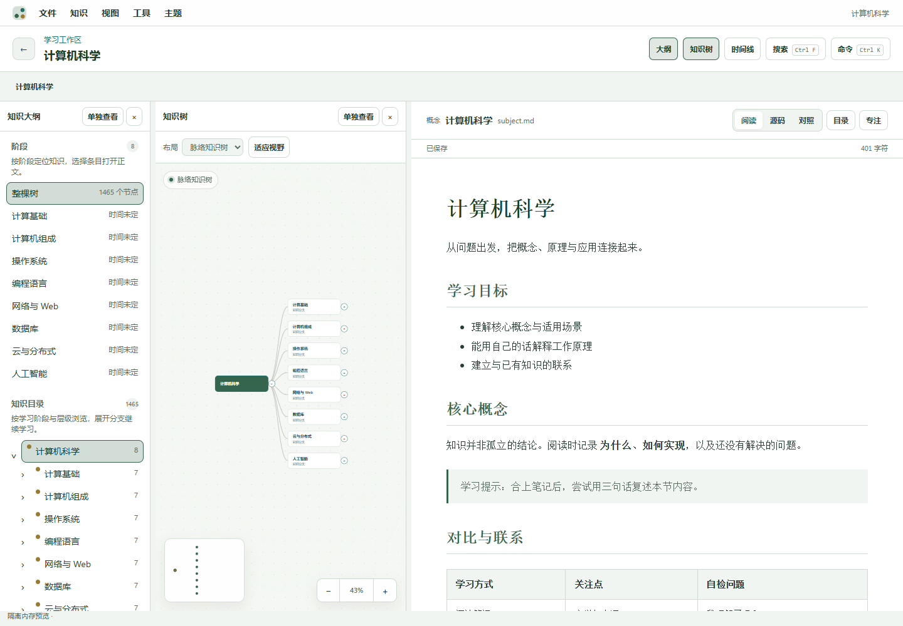

# KnowledgeTree 0.1.2

本地知识整理桌面应用：用树组织知识，用 Markdown 编辑正文，用 YAML 保存结构，并为学科记录 Git 历史。重点是节点创建、搜索定位和可靠保存。



[下载 Windows 版本](https://github.com/snowfeeling3/KnowledgeTree/releases/tag/v0.1.2) · [更新记录](CHANGELOG.md) · [验证与限制](docs/RELEASE_VALIDATION.md)

Windows x64 NSIS 安装包需要 WebView2，未签名；macOS/Linux 尚未验证。开发环境验证：Windows、Node 22、GNU Rust stable。新版安装包包含当前 Markdown 工作区源码，不再沿用旧版 0.1.1 产物。

## 现在能做什么

1. 在文档库里创建学科。
2. 创建阶段、节点和有向关系。阶段可以改名称、描述、年份和顺序；仍被节点使用时不能删除。
3. 用父节点形成树，并自动布局。
4. 打开节点对应的 Markdown；编辑后自动保存，Ctrl+S 立即保存，失败时保留草稿。
5. 修改节点的标题、类型、阶段、上级、状态和标签。正文和已有来源属性会保留。
6. 修改来源、发明者、组织、年份、目的、问题、方案和引用。不会改写正文或树。
7. 按标题、标签、属性和正文搜索。
8. 切换 Everforest、Light、Dark。
9. 按阶段时间线过滤树。
10. 查看最近的知识提交和文件差异。
11. 默认使用插画知识树：先生成单主干、5 根主枝和有留白的树冠，再映射知识。远景显示学科、阶段组和主要主题；放大后显示领域、主题和技术；单击节点选择并预览，点击 `+N` 展开集合，Enter 打开完整正文。
12. 在「视图 → 插画知识树 / 传统树布局」中切换布局，选择会保存到本机。插画模式初次打开时优先展示整棵树；大纲、时间线和正文仍可通过视图菜单展开。
13. 选中节点后按 N 快速创建子节点，Shift+N 创建同级，F2 行内重命名；Ctrl+F 搜索并定位，F 聚焦分枝，Ctrl+K 打开命令面板。
14. 正文和属性支持自动保存；面板支持预览、打开和固定。编辑模式支持拖拽移动与 Shift 拖拽建立关系，结构操作可用 Ctrl+Z / Ctrl+Shift+Z 撤销、重做。

首次启动选择知识库目录，推荐文档目录下的 `KnowledgeTree`；迁移旧库请手动选择目录，或显式设置 `KNOWLEDGE_TREE_LEGACY_LIBRARY`。配置与草稿保存到系统配置目录，知识库独立保存。每个学科是一个文件夹，也是一个 Git 仓库：结构写在 YAML，正文写在 Markdown。需要本机有 `git`。没有 Git 时文件仍会保存。

## 当前约定

- 学科仓库中的 YAML 保存结构、关系和属性；Markdown 保存可自由扩展的知识正文。
- 插画布局先生成固定容量的视觉骨架：Subject 对应整树，Stage 对应主枝，Domain / Major Topic 对应二级枝，Technology 对应枝梢；Concept 主要在知识列表和文档中展开，装饰叶片不与每个概念一一对应。
- 超过 5 个阶段时按顺序组成阶段组，再按照子树大小分配枝区；每根主枝最多 4 个领域，每个领域最多 3 个技术代表。其余内容通过 `+N` 摘要和可搜索列表访问，不继续递归长枝。
- 标签保持屏幕字号，按屏幕边界避碰。远景最多 12–16 个、中景 28 个、近景 50 个；悬停和选择保持同一预算，完整名称和属性由提示及正文面板展示。
- 树形由确定性的 Bézier 骨架和互不相交的枝区生成。缩放、平移、悬停和选择只更新投影，不重建树形。旧布局模块继续保留。
- 新建技术节点的 Markdown 使用中英对照的学习模板；任何节点都可以继续添加子节点，不限制层级深度。
- 功能说明以当前源码和此 README 为准，旧版规划文档已移除，避免与实现产生歧义。

## 开发

需要 Rust stable、Node.js 22 和 pnpm。Windows 上 Tauri 官方推荐 MSVC。已安装 MinGW 时，GNU 工具链也可以编译这个桌面壳；如果链接失败，再安装 Visual Studio Build Tools。

```powershell
pnpm install
cargo test -p kt-core
pnpm test:ui
pnpm dev
```

`pnpm dev` 在 Windows 上会优先使用当前可用的 MSVC 环境；若缺少 `link.exe`，会选择已安装的 GNU/MinGW 工具链，不修改全局 Rust 设置。可运行 `node scripts/dev-desktop.cjs --check` 检查工具链。启动前会检查 1420 端口，若已有预览或开发进程占用，请先关闭对应终端。

`pnpm dev` 会启动 Tauri，并在 `127.0.0.1:1420` 拉起前端。可用环境变量 `KNOWLEDGE_TREE_LIBRARY` 指定知识库目录。

## 插画布局预览与验证

运行 `pnpm --dir frontend dev` 后打开 `http://127.0.0.1:1420/illustrated-tree-preview.html`，可查看包含 1,465 个知识点的压力示例。添加 `?workspace` 可预览实际工作区交互；该预览使用隔离的可写内存适配器，不修改知识库，刷新会重置预览数据。

设计与验收记录见 [docs/illustrated-tree-layout.md](docs/illustrated-tree-layout.md)。布局、映射、标签碰撞、数据可达性及旧布局回归都由 `pnpm test:ui` 验证。

交互审查、快捷键、模块边界、保存与撤销规则见 [docs/ux-interaction-optimization.md](docs/ux-interaction-optimization.md)。

## 启动方式

- 开发时使用 `pnpm dev`。它会同时启动 Vite 与 Tauri；不要直接双击 `target\\debug` 下的可执行文件，因为调试版需要连接 Vite，未启动开发服务器时会显示本地网络错误。
- 日常使用请构建正式版：`pnpm --dir apps/desktop build`。随后直接运行 `target\\release\\knowledge-tree-desktop.exe`；正式版把前端资源内置在应用中，不依赖 `127.0.0.1:1420` 或任何网络连接。


## License

[MIT](LICENSE)。第三方依赖保留各自许可，见 [THIRD-PARTY-NOTICES](THIRD-PARTY-NOTICES.md)。
